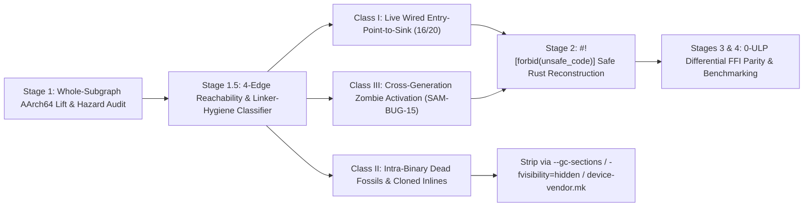
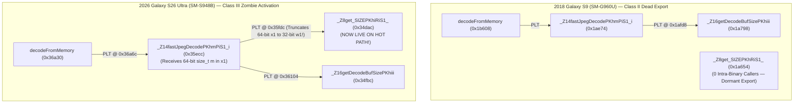

# Live Attack Surface, Dead Fossils, and Zombie Activation: Multi-Edge Reachability and Linker-Hygiene Auditing of Stripped Android Vendor Binaries

**Author:** M. Larrabee (`PNWcoastie`), Independent Systems & Security Researcher  
**Date:** November 2026  
**Document Classification:** Public Research Release — Part II Follow-Up Study  
**Predecessor Study (Part I):** *The Borrow Checker as a Binary Auditor: Discovering Multi-Generation Android Firmware Defects via `#![forbid(unsafe_code)]` Safe Rust Reconstruction* ([`DOI: 10.5281/zenodo.24261883`](https://doi.org/10.5281/zenodo.24261883))  
**Companion Artifact & Reference Crate:** [`PNWcoastie/binary-reachability-and-fossil-debt`](https://github.com/PNWcoastie/binary-reachability-and-fossil-debt) (`s9_blur_detection`)  
**Target Ecosystems Evaluated (`53` AArch64 ELF64 Binaries + `1` Signed Biometric APEX):**

* **Baseline Generation (2018 / Android 10):** Samsung Galaxy S9 (`SM-G960U` / `starqltesq`, Qualcomm Snapdragon 845 `SDM845`, Firmware `G960USQU9FVB2` — `28` ELF64 binaries)  
* **Modern Production Flagship Generation (2025 to 2026 / Android 16, One UI 8):**  
  * Samsung Galaxy S25 Ultra (`SM-S938B`, Firmware `BP4A.251205.006.S938BXXU9CZDP` — `7` ELF64 binaries)  
  * Samsung Galaxy S26 Ultra (`SM-S948B`, Firmware `BP4A.251205.006.S948BXXS2AZE2` — `18` ELF64 binaries + `com.samsung.android.biometrics.face.signed.apex`)

---

# Abstract

In our preceding study ([`DOI: 10.5281/zenodo.24261883`](https://doi.org/10.5281/zenodo.24261883)), we demonstrated that reconstructing stripped `aarch64` vendor shared libraries (`.so`) into `#![forbid(unsafe_code)]` Safe Rust and verifying bit-exact equivalence via differential Foreign Function Interface (FFI) fuzzing acts as a deterministic vulnerability discovery oracle, uncovering 20 silent C/C++ memory, arithmetic, and concurrency defects (`SAM-BUG-01` through `SAM-BUG-20`) across 11 native subsystems. However, when presented with static or binary-level defect reports in prebuilt vendor blobs, original equipment manufacturer (OEM) Product Security Incident Response Teams (PSIRTs) and platform engineering leads routinely raise a pragmatic triage objection: *Given hundreds of legacy `.so` files accumulated in `/vendor/lib64/` and `/system/system/lib64/` across device generations, which defects reside on live production execution paths, and which are unreachable "factory-line fossils" that do not warrant engineering cycles?*

This paper introduces **Stage 1.5: Multi-Edge Binary Reachability and Linker-Hygiene Auditing**, a systematic methodology that bridges micro-architectural defect discovery (Stage 1) and `#![forbid(unsafe_code)]` Safe Rust reconstruction (Stage 2). First, we show why naive cross-binary ELF `DT_NEEDED` and `.dynsym` (`UND`) scanners fail on modern mobile operating systems due to **four dynamic linkage mechanisms** (`dlopen`/`dlsym` plugin tables, JNI `RegisterNatives` arrays in `.data`/`.data.rel.ro`, polymorphic C++ virtual method tables, and Bionic linker namespace whitelists) and **five C++ ABI linker-collision artifacts** (`_Znwm`/`_ZdlPv` NDK static-link collisions, weak `std::__1` typeinfo re-exports, statically linked `libyuv` symbol collisions, unscoped callback name collisions, and `.rodata` substring false positives).

Second, applying our multi-edge reachability analyzer across all 20 defects (`SAM-BUG-01` through `SAM-BUG-20`) and 53 ELF64 binaries from the Galaxy S9 (`SM-G960U`), Galaxy S25 Ultra (`SM-S938B`), and Galaxy S26 Ultra (`SM-S948B`), we establish that binary defects partition into **three empirical classes**:
1. **Class I — Live Wired Production Paths (`16 of 20` defects):** Unbroken intra-binary and cross-binary call chains connect top-level public entry points (`JNI_OnLoad`, `Java_*` exports, `HMI` HAL modules, and `dlsym` C plugin factories) directly to the vulnerable instruction site.
2. **Class II — Intra-Binary Dead Fossils & Cloned Inlines (`SAM-BUG-19`, half of `SAM-BUG-12`, and the `ButterworthFilter` subgraph of `SAM-BUG-11`):** Exported `GLOBAL DEFAULT` functions that have `0` internal or external callers because developers inlined or multithreaded the routine (`libsrib_outfocus.camera.samsung.so`) or migrated to a file-descriptor variant (`libIrisTlc.so`) without deleting the legacy function or enabling `-fvisibility=hidden`.
3. **Class III — Cross-Generation "Zombie Activation" (`SAM-BUG-15` in `libsecimaging_pdk.camera.samsung.so`):** We prove empirically that Class II dead fossils are not harmless. On the 2018 Galaxy S9 (`0x1a654`), `_Z8get_SIZEPKhRiS1_` was an unreferenced Class II export (`0` callers). By Android 16 on the Galaxy S25 Ultra and S26 Ultra (`0x34dac`), a refactoring of `_Z14fastJpegDecodePKhmPiS1_i` (`0x35ecc`) wired `_Z8get_SIZEPKhiRiS1_` directly into the live `decodeFromMemory` execution path (`0x35fdc`), truncating a 64-bit `size_t` buffer length into a 32-bit signed `int`.

Finally, we audit symbol-visibility hygiene across the Android 16 flagship corpus, showing that **16 of 18 evaluated S26 Ultra ELF libraries omit `-fvisibility=hidden`**, exporting `90% to 95%` of their internal functions (`up to 2,073 symbols per library`) as `GLOBAL DEFAULT` and routing `100%` of intra-binary calls through `.plt` jump slots. We accompany this paper with a standalone `#![forbid(unsafe_code)]` Safe Rust reference crate (`s9_blur_detection`), reconstructing `libBlurDetection.camera.samsung.so` (`SAM-BUG-10` and `SAM-BUG-10b`) with `0 ULP` bit-exact parity and a **`1.18×` to `2.66×` speedup** across **30,118 self-executing SplitMix64 and boundary test vectors**.

---

# 1. Introduction: The "Unreachable Fossil" Triage Fallacy

## 1.1 The Post-Discovery Triage Bottleneck

When static analysis or `#![forbid(unsafe_code)]` binary reconstruction uncovers memory-safety and arithmetic defects inside prebuilt vendor shared libraries, two competing perspectives collide:

1. **The Vendor PSIRT Perspective:** Mobile OEMs maintain sprawling `/vendor/lib64/` and `/system/system/lib64/` directories governed by inherited `device-vendor.mk` and `PRODUCT_COPY_FILES` build manifests. Because removing a prebuilt `.so` risks breaking camera modes or carrier certification on regional SKUs, obsolete libraries and deprecated C++ helper methods accumulate across generations. Consequently, triage teams routinely dismiss library-level defects (`CWE-680` integer-overflow-to-buffer-overflow, `CWE-787` out-of-bounds writes, `CWE-476` null-dereference-before-check) as "informational code quality debt" unless an external researcher provides an end-to-end exploit chain proving runtime reachability.
2. **The Platform Security Perspective:** From the standpoint of operating system security architects (e.g., Android's platform Rust and memory-safety initiatives), engineering bandwidth is finite. If an automated binary audit flags 20 defects across 11 libraries, platform teams need an automated, deterministic stage (**Stage 1.5**) that separates **actively linked production attack surface** (which requires immediate patching or `#![forbid(unsafe_code)]` Rust replacement) from **dead factory-line fossils** (which can be stripped from the build manifest or hidden via compiler visibility flags at near-zero engineering cost).

## 1.2 Why All Three Reachability Classes Matter

A central empirical finding of this paper is that **the vendor assumption that "uncalled code inside a shipped binary is harmless" is demonstrably false over multi-year firmware lifecycles.** By tracking the exact intra-binary and cross-binary call graphs of all 20 defects from Android 10 (`SM-G960U`, 2018) to Android 16 (`SM-S938B` and `SM-S948B`, 2025–2026), we show that every defect falls into one of three operational classes—and **all three classes require engineering action**:

* **Class I (Live Wired Production Paths):** The vulnerable instruction lies on an unbroken call chain originating at an exported JNI, Binder/HIDL/AIDL HAL, or plugin vtable entry point. These defects represent immediate runtime memory-safety or availability hazards.
* **Class II (Intra-Binary Dead Fossils & Cloned Inlines):** The specific exported function has `0` internal callers inside its `.so` and `0` external importers in the target corpus. However, because the vendor omitted `-fvisibility=hidden` and `--gc-sections`, the buggy machine code remains mapped into executable memory and exported as a `GLOBAL DEFAULT` symbol in `.dynsym` (callable via `dlsym()` or PLT interposition). Worse, as we prove in Case Study 2 (`SAM-BUG-19`), when developers abandon a standalone helper function in favor of a multithreaded or inlined version without fixing the underlying math, the live replacement frequently inherits the exact same defect.
* **Class III (Cross-Generation "Zombie Activation"):** In Case Study 3 (`SAM-BUG-15`), we document a smoking-gun transition: `_Z8get_SIZEPKhRiS1_` (`0x1a654` in `libsecimaging_pdk.camera.samsung.so`) was a **Class II unreferenced export (`0` callers)** in 2018 on the Galaxy S9. Rather than deleting the dead function, Samsung retained it in the source tree; by 2026 on the Galaxy S25 Ultra and S26 Ultra, a developer refactoring `_Z14fastJpegDecodePKhmPiS1_i` (`0x35ecc`) modified `_Z8get_SIZEPKhiRiS1_` (`0x34dac`) to accept a 32-bit signed `int` length and **wired it directly into the live `decodeFromMemory` hot path (`0x35fdc`)**, creating a 64-to-32-bit size truncation (`size_t m` $\to$ `int i`) on active JPEG decoding.

---

# 2. Methodology: The Stage 1.5 Four-Edge Reachability & Linker-Hygiene Model

## 2.1 Why Naive `DT_NEEDED` / `.dynsym` Scanners Fail on Android Firmware

A naive reachability tool that only parses ELF `DT_NEEDED` tags (`readelf -d`) and matches undefined `.dynsym` (`UND`) symbol names across `/system/lib64/` and `/vendor/lib64/` fails in both directions on Android firmware, producing **massive false negatives** (missing real production callers) and **massive false positives** (hallucinating bogus cross-binary links).

### 2.1.1 The Four Universal Dynamic-Linkage Edges (Preventing False Negatives)

To capture real execution paths across modern binary ecosystems (Android/Linux ELF, Windows PE, macOS Mach-O), Stage 1.5 models **intra-binary call graphs** alongside **four cross-binary linkage edges**:

| Linkage Layer / Edge Type | Android / Linux ELF Realization (Evaluated in This Study) | Cross-Platform Equivalent (Windows / Automotive / macOS) |
| :--- | :--- | :--- |
| **Intra-Binary Call Graph (Closed-World)** | 1. Direct `.text` PC-relative branches (`BL` `0x94000000`, `B` `0x14000000`). 2. Intra-module `.plt` calls (`ADRP x16` + `LDR x17, [x16, #off]` resolving to `R_AARCH64_JUMP_SLOT` in `.rela.plt`). 3. Virtual method & callback tables in `.data.rel.ro` / `.data` (`R_AARCH64_ABS64`, `R_AARCH64_RELATIVE`, and packed Android `.relr.dyn` relocations). | Direct `CALL rel32`, IAT thunks, PE `.rdata` C++ vtables, Mach-O `__stubs` and `__const` vtables. |
| **Edge 1: Static Loader Dependency (`DT_NEEDED` + `.dynsym` `UND`)** | Caller ELF declares `DT_NEEDED: [callee.so]` and imports mangled C/C++ symbol in `.dynsym` (`Ndx == UND`), resolved by Bionic at load time (e.g., `face.default.so` $\to$ `libFaceService.so`; `iris.default.so` $\to$ `libIrisService.so` $\to$ `libIrisTlc.so`; `libandroid_servers.so` $\to$ `libsensorservice.so`). | PE Import Address Table (`IAT`), Mach-O `LC_LOAD_DYLIB`. |
| **Edge 2: Runtime Plugin Orchestration (`dlopen` / `dlsym` + `.rodata` / XML)** | Orchestrator imports `dlopen`/`android_dlopen_ext` and `dlsym`, loading plugin `.so` filenames stored in `.rodata` string literals or `/vendor/etc/camera/*.xml` manifests (e.g., `libsrib_humanaware_engine.camera.samsung.so` dynamically loading `libsrib_clarity_scorer.camera.samsung.so`, `libFace_Landmark_Engine.camera.samsung.so`, and `libImageSegmenter_v1.camera.samsung.so`). | Windows `LoadLibrary` + `GetProcAddress`, QNX/ADAS plugin manifests. |
| **Edge 3: Managed-to-Native FFI Bridges (`JNI` `Java_*` & `RegisterNatives`)** | Privileged Java/Kotlin system services (`SamsungCamera.apk`, `system_server`) call `System.loadLibrary(...)` and invoke either exported `Java_com_...` symbols (`libjni_dualcamera.so`, `libportrait_controller_interface_jni.camera.samsung.so`, `libdvs.camera.samsung.so`) OR `JNI_OnLoad`, which passes a static `JNINativeMethod` `(name, sig, fn_ptr)` array in `.data` / `.data.rel.ro` to `RegisterNatives` (`libsemcamera_jni.camera.samsung.so`, `libsecimaging.camera.samsung.so`). | .NET `P/Invoke`, Python `PyMethodDef` / `ctypes`, Electron N-API. |
| **Edge 4: Polymorphic C++ Vtable & HAL `HMI` Struct Dispatch** | Caller resolves a single exported C factory (`HumanTrackingHelper_Get`, `createSceneDetector`, `SRIBEngineInit`) or Android HAL `HMI` (`hw_module_t` in `face.default.so`, `iris.default.so`) and invokes methods indirectly via `.data.rel.ro` virtual function tables (`ldr x8, [x0, #vtable_off]; blr x8`). | Windows `COM` (`IUnknown` vtables), Linux `ioctl` / `file_operations` tables. |

---

### 2.1.2 The Five False-Positive C++ Linker Traps (Preventing Bogus Edges)

During our adversarial red-team audit of raw `.dynsym` matching across the 53 binaries, we identified **five linker-resolution artifacts** that corrupt naive static dependency graphs if left unfiltered:

1. **Trap 1 — NDK Static C++ Runtime Re-Exports (`_Znwm` / `_ZdlPv` Collisions):** On the Galaxy S9, `libSDSensorWrapper.camera.samsung.so` was linked against the Android NDK C++ runtime without `--exclude-libs ALL`, causing it to export `GLOBAL`/`WEAK` definitions of `operator new` (`_Znwm`), `operator delete` (`_ZdlPv`), and `__cxa_begin_catch`. An unscoped symbol matcher falsely assigns **21 incoming cross-binary edges** to `libSDSensorWrapper.camera.samsung.so` from `libandroid_runtime.so`, `gralloc.sdm845.so`, and `libsensorservice.so`—all of which actually resolve `_Znwm` from `libc++.so` via `DT_NEEDED` at runtime.
2. **Trap 2 — Weak `std::__1` Typeinfo (`_ZTI*`) and Vtable (`_ZTV*` / `_ZTT*`) Collisions:** On the S25 Ultra and S26 Ultra, `libFaceService.so`, `libsecimaging.camera.samsung.so`, `libsecimaging_pdk.camera.samsung.so`, and `libsrib_humanaware_engine.camera.samsung.so` export weak C++ exception typeinfo symbols (`_ZTISt12length_error`, `_ZTISt9bad_alloc`) and `std::__1::basic_ostringstream` vtables (`_ZTVNSt3__119basic_ostringstream...`). Unscoped matching falsely links unrelated camera and sensor libraries to `libFaceService.so` over shared STL template instantiations.
3. **Trap 3 — Statically Linked Third-Party Library Collisions (`libyuv`):** On Android 16 (`SM-S938B` and `SM-S948B`), `libFaceService.so` declares `DT_NEEDED: [libyuv.so]` and imports `NV12Scale`. Because `libsecimaging.camera.samsung.so` and `libsecimaging_pdk.camera.samsung.so` statically linked `libyuv` without hiding its symbols, they export `GLOBAL DEFAULT` copies of `NV12Scale`, `I420Scale`, and `I420ToNV21`. Only scoping `DYNSYM_IMPORT` resolution to the caller's `DT_NEEDED` closure prevents falsely linking `libFaceService.so` to `libsecimaging*.so`.
4. **Trap 4 — Identical C Callback Symbol Names Across Sibling HALs (`ss_set_notify_callback`):** On the S9, both `libFaceService.so` (`DT_NEEDED` by `face.default.so`) and `libIrisService.so` (`DT_NEEDED` by `iris.default.so`) export `ss_set_notify_callback`. Scoping imports strictly by `DT_NEEDED` prevents cross-linking `face.default.so` to `libIrisService.so`.
5. **Trap 5 — `.rodata` System Property Substring Collisions (`"ro.camera.sound.forced"`):** Scanning `.rodata` for the 3-character substring `".so"` falsely matches Android system property strings such as `"ro.camera.sound.forced"` (`".sound"`) and CRT abort messages (`"Cannot dlopen libc.so: %s"`). Stage 1.5 enforces strict library token regexes (`\b[A-Za-z0-9_.\-@]+\.so(?:\.\d+)*\b`) paired with `dlopen` / `android_dlopen_ext` import verification.

## 2.2 Closed-World vs. Open-World Corpus Guarantees

Because our Android 16 evaluation examines a targeted extraction of 25 flagship camera, sensor, and biometric binaries (plus 1 signed APEX container) rather than all ~900 files in `/vendor/lib64/`, Stage 1.5 strictly distinguishes between:
* **Closed-World Proofs (100% Complete Within Each ELF Binary):** Intra-binary call graphs (`Direct BL`, `.plt` jump slots, and `.data.rel.ro` / `.data` / `.relr.dyn` function-pointer tables) and `.dynsym` visibility tables (`GLOBAL DEFAULT` export counts) are intrinsic mathematical properties of the individual ELF binary. Proving that a function has `0` intra-binary callers inside its own `.so`, or that a `.so` exports `1,477` `GLOBAL DEFAULT` functions, requires zero external files.
* **Existential Cross-Binary Proofs vs. Sub-Corpus Non-Witnesses:** Positive cross-binary chains (e.g., `face.default.so` $\to$ `libFaceService.so` or `libsrib_humanaware_engine.camera.samsung.so` $\to$ `dlopen("libsrib_clarity_scorer.camera.samsung.so")`) are constructive existential proofs. When a plugin library has `0` incoming `DT_NEEDED` edges within our 53-binary sub-corpus, we classify its external linkage as *Loaded by External HAL Host (`cameraserver` / Camera Provider) via Exported Entry Point*.

---

# 3. Master Stage 1.5 Reachability & Class I / II / III Taxonomy (`SAM-BUG-01` .. `SAM-BUG-20`)

The table below presents the complete, instruction-verified Stage 1.5 classification across all 20 defects discovered in Part I ([`DOI: 10.5281/zenodo.24261883`](https://doi.org/10.5281/zenodo.24261883)):

| Bug ID | Binary (`aarch64` ELF) | Vulnerable Function & VA (`S9` / `S26U`) | Verified Intra-Binary Entry-Point-to-Sink Call Chain | Cross-Binary Linkage Edge (4-Edge Model) | Stage 1.5 Class & Android 16 (`SM-S948B`) Status |
| :--- | :--- | :--- | :--- | :--- | :--- |
| **SAM-BUG-01** | `libgyroscope.camera.samsung.so` | `SecGyroCalibration::Init` (`0x3260`) $\to$ `Filter::Filter(50)` (`0x3a90`) & `movingAverage` (`0x3b20`) | **Alloc:** `Gyroscope_Lib::initializeLib` (`0x4ac0`) $\xrightarrow{\text{PLT@0x4b10}}$ `GyroscopeLib::C1` (`0x3fb0`) $\xrightarrow{\text{PLT@0x4000}}$ `SecGyroCalibration::C1` (`0x31f0`) $\xrightarrow{\text{PLT@0x3260}}$ `Filter(50)` (`0x3a90`). **Trigger:** `Gyroscope_Lib::processEvent` (`0x4ab0`) $\xrightarrow{\text{PLT@0x4abc}}$ `processGyro` (`0x4130`) $\xrightarrow{\text{PLT@0x41a0}}$ `SecGyroCalibration::process` (`0x35f0`) $\xrightarrow{\text{PLT@0x3660}}$ `movingAverage` (`0x3b20`). *(Note: secondary caller `IsDeviceNotInMotion_Gyro@0x34f0` has `0` intra-binary callers.)* | **Edge 2 (`dlopen`/`dlsym`) + Edge 1 (`.dynsym` export):** Camera HAL EIS node resolves `initializeLib` and `processEvent`. | **Class I (Live Wired)** on S9 (`300`-byte `float[25][3]` overflow). |
| **SAM-BUG-02** | `libhumantracking_util.camera.samsung.so` | `ArcSoftHumanTrackingHelper::unInitializeHumanTracking` (`0x40f0..0x4124`) | Exported C factory `HumanTrackingHelper_Get` (`0x20c8` S9 / `0x40e8` S25U & S26U) constructs `ArcSoftHumanTrackingHelper` and installs `.data.rel.ro` vtable `0x6020` (`R_AARCH64_RELATIVE`). Vtable slot `vtable[6]` (`0x41f4`) and destructor `~ArcSoftHumanTrackingHelper` (`0x2734`) $\xrightarrow{\text{Direct BL}}$ `unInitializeHumanTrackingLocked` (`0x24a4`) $\xrightarrow{\text{Direct BL}}$ `0x4014` (`ldr x8, [x19, #0x30]!; str xzr, [x19, #0x30]`). | **Edge 2 (`dlsym`) + Edge 4 (`.data.rel.ro` Vtable):** Host calls `HumanTrackingHelper_Get` and dispatches via vtable; outgoing **Edge 1 (`DT_NEEDED`)** to `libhumantracking.arcsoft.so` (`ARC_HT_Uninit`). | **Class I (Live Wired) — Active in S25U & S26U** (`BuildID: 35a43804...` bit-identical across S25U & S26U). |
| **SAM-BUG-03** | `libFaceService.so` | `FaceService::request` (`cmd_id == 11`, `0x4b70` $\to$ `0x4c44..0x4c68`) | Exported C wrapper `ss_face_request` (`0x6010`) $\xrightarrow{\text{PLT@0x6090}}$ `FaceService::request` (`0x4b70` $\to$ `subs sp, x22, w8, sxtw #0` at `0x4c44`). | **Edge 1 (`DT_NEEDED`) + Edge 4 (`HMI`):** `face.default.so` (`HMI` @ `0x3010`) $\to$ `face_request` (`0x1010`) $\xrightarrow{\text{PLT}}$ `ss_face_request`. | **Class I (Live Wired)** on S9; legacy `request(cmd_id==11)` removed in S25U/S26U AIDL V4 rewrite. |
| **SAM-BUG-04** | `libFaceService.so` & `libIrisService.so` | `FaceServiceStorage::setStorePath` (`0x7860` $\to$ `0x78dc`) & `IrisServiceStorage::setStorePath` (`0x10f88` / `0x1bf48`) | **Face:** `ss_face_set_active_group` (`0x5e70`) $\xrightarrow{\text{PLT@0x5eb0}}$ `setActiveGroup` (`0x46a0`) $\xrightarrow{\text{PLT@0x46e0}}$ `setStorePath` (`0x7860`). **Iris:** `ss_iris_set_active_group` (`0x16a50`) / `ss_iris_setIB_active_group` (`0x16b20`) $\xrightarrow{\text{PLT}}$ `IrisServiceStorage::setStorePath` (`0x10f88`). | **Edge 1 (`DT_NEEDED`) + Edge 4 (`HMI`):** `face.default.so` $\to$ `ss_face_set_active_group`; `iris.default.so` $\to$ `ss_iris_set_active_group`. | **Class I (Live Wired)** on S9; refactored to `std::string` (`0x40bb4`) in S26U, while new `readDataFile` (`0x438e0`) is **Class I Live Wired** via 3 AIDL chains. |
| **SAM-BUG-05** | `libFaceService.so` | `FaceService::authenticate` (`0x4710` $\to$ `0x479c`) & `migrateInterimTemplate` (`0x4f60` $\to$ `0x4fd0`) | `ss_face_authenticate` (`0x5ee0`) $\xrightarrow{\text{PLT@0x5f58}}$ `FaceService::authenticate` (`0x4710`); `ss_face_request` (`0x6010`) $\xrightarrow{\text{PLT@0x6090}}$ `request` (`0x4b70`) $\xrightarrow{\text{PLT@0x4d2c}}$ `migrateInterimTemplate` (`0x4f60`). | **Edge 1 (`DT_NEEDED`) + Edge 4 (`HMI`):** `face.default.so` (`HMI`) $\to$ `ss_face_authenticate` & `ss_face_request`. | **Class I (Live Wired)** on S9 (`strlen(mStorePath)` before `cbz` null check); persists in S25U/S26U at `0x585c`. |
| **SAM-BUG-06** | `libsemcamera_jni.camera.samsung.so` | `JNISemCameraContext::_setOutputFileArray` (`0x91a8` $\to$ `0x922c..0x92ac`) | Exported `JNI_OnLoad` (`0x6f7c`) $\xrightarrow{\text{PLT@0x7008}}$ `register_com_samsung_android_camera_core_SemCamera` (`0x6c0c`) passes `.data` table `gMethods` (`0xa008`), where slot `0xa2f0` (`.relr.dyn`) binds Java `_setOutputFileArray(FileDescriptor[])` to local VA `0x91a8`. | **Edge 3 (`JNI_OnLoad` `RegisterNatives`):** Invoked directly from Java `SemCamera._setOutputFileArray`. | **Class I (Live Wired)** via `.data` `JNINativeMethod` table (`int fd_array[32]` stack overflow). |
| **SAM-BUG-07** | `libFaceService.so` & `libIrisService.so` | `FaceService::migrateInterimTemplate` (`0x4f74`, `525,408` B stack) & `IrisWorkerManager::processIRImage` (`0x1e7f8`, `565,472` B stack) | **Face:** `ss_face_request` (`0x6010`) $\to$ `request` (`0x4b70`) $\to$ `migrateInterimTemplate` (`0x4f60`). **Iris:** `ss_iris_createInputSurface` (`0x172d0`) $\to$ `createInputSurface` (`0x155c8`) $\to$ `IrisWorkerManager::renderWorkingThread` (`0x1e170`) $\to$ `processIRImage` (`0x1e7f8`). | **Edge 1 (`DT_NEEDED`) + Edge 4 (`HMI`):** Reached from `face.default.so` and `iris.default.so` HAL modules. | **Class I (Live Wired)** on S9 (`>512 KiB` thread stack frames). |
| **SAM-BUG-08** | `libIrisSensorListener.so` | `LightSensorListener::getSensorData(float*)` (`0x28e0`) & `sensorEventCallback` (`0x2af0`, `832` B uninit stack) | Exported `light_sensor_listener_get_data` (`0x2f90`) $\xrightarrow{\text{PLT@0x2f94}}$ `getSensorData` (`0x28e0`); exported `light_sensor_listener_enable_sensor` (`0x2e90`) $\to$ `enableSensor` (`0x24d0`) $\to$ `startLoop` (`0x2630`) $\to$ vtable `0x4a10` `threadLoop` (`0x3110`) $\to$ `sensorEventCallback` (`0x2af0`). | **Edge 2 (`dlopen`/`dlsym`) + Edge 4 (`.data.rel.ro` Vtable):** C wrapper exports + `SensorListenerThread` vtable `0x4a10`. | **Class I (Live Wired)** on S9. |
| **SAM-BUG-09** | `libIrisService.so` | `IrisWorkerManager::processIRImage` / `processEnroll` (`0x19d80..0x19e10` & `0x1e7f8`) | `ss_iris_createInputSurface` (`0x172d0`) $\to$ `IrisWorkerManager::renderWorkingThread` (`0x1e170`) $\to$ `processIRImage` (`0x1e7f8`), calling `PLT:IrisServiceStorage::storeTemplate` (`0x100d0`) twice back-to-back at `0x1ee18` and `0x1ee64`. | **Edge 1 (`DT_NEEDED`) + Edge 4 (`HMI`):** `iris.default.so` $\to$ `libIrisService.so`. | **Class I (Live Wired)** on S9. |
| **SAM-BUG-10** (& **10b**) | `libBlurDetection.camera.samsung.so` | `compute_blur` (`0x1c08` $\to$ `0x1c68`), `get_blur_val` (`0x1710`), `calc_low_texture` (`0x15d4` $\to$ `0x16d8`), `get_cnt_lt` (`0x138c`) | Exported `compute_blur` (`0x1c08`) $\xrightarrow{\text{PLT@0x1dc4}}$ `get_blur_val` (`0x1710`) $\xrightarrow{\text{PLT@0x1740}}$ `_Z16calc_low_texturePhiiS_` (`0x15d4`) $\xrightarrow{\text{PLT@0x165c, 0x16a0}}$ `_Z10get_dif_ltPhiiiS_` (`0x0fc8`) & `_Z10get_cnt_ltPhS_iiiPiS0_S0_S0_` (`0x138c`). | **Edge 2 (`dlopen`/`dlsym`) + Edge 1 (`.dynsym` export):** Camera HAL loads `compute_blur` / `get_blur_val`. | **Class I (Live Wired)** on S9 (5× unchecked `malloc` + `SAM-BUG-10b` dead low-texture gate); replaced by TFLite `libBlurDetectionDeepLearning.camera.samsung.so` on S25U. |
| **SAM-BUG-11** | `libsensorservice.so` | 20 MRE `.bss` routines (`0x70580..0x76158` on S9; `0x9ec04..0xa9238` on S25U/S26U) | **1. Live MRE Subgraph (18 routines):** `SensorService` (`sub_797e0` on S26U) $\to$ `PLT:GetMotionScenarioId` (`0xa15b4`) $\to$ `GyroCalMain` (`0xa7514`) $\to$ `CalibrateGyroOffset_gyro` (`0xa79f0`), and `MotionRecognitionEngineThread` (`0xa1a74`) $\to$ `ManageMotionScenario` (`0x9ec04`) $\to$ `ExecuteMotionEngine` (`0xa3dd8`). **2. Dead Subgraph (2 routines):** `InitializeAccDataFilter` (`0x75c00` S9 / `0xa8fa8` S26U) and `AccDataFilter` (`0x75e5c` S9 / `0xa9204` S26U) $\to$ `ButterworthFilter` (`0x75c20` S9 / `0xa8fd0` S26U) have **`0` callers (`0` BL, `0` PLT, `0` vtable)**. | **Edge 1 (`DT_NEEDED`):** Directly imported by `libandroid_servers.so` (`system_server`) and `/system/bin/sensorservice`. | **Split Class I (18 Live MRE `.bss` routines) + Class II (`AccDataFilter` $\to$ `ButterworthFilter` Dead Fossil Subgraph)** across S9, S25U, and S26U! |
| **SAM-BUG-12** | `libIrisTlc.so` | `IrisTlc_GetPreviewFrame_NV21` (`0x8190` $\to$ `0x8430`) & `IrisTlc_secure_preview_with_mem` (`0x9ed0` $\to$ `0x9f70`) | **1. `IrisTlc_GetPreviewFrame_NV21` (`0x8190`):** Actively called by `libIrisService.so` (`IrisDisplayManager::processFrontImage` @ `0x1a444` & `0x1a4c0` $\leftarrow$ `ss_iris_processFrontImage@0x170d4`). **2. `IrisTlc_secure_preview_with_mem` (`0x9ed0`):** **`0` intra-binary callers and `0` cross-binary imports** (`libIrisService.so` migrated to `IrisTlc_secure_preview_with_fd@0x1bf4c`). | **Edge 1 (`DT_NEEDED`):** `iris.default.so` $\to$ `libIrisService.so` $\to$ `libIrisTlc.so`. | **Split Class I (`IrisTlc_GetPreviewFrame_NV21` Live Wired) + Class II (`IrisTlc_secure_preview_with_mem` Dead Exported Fossil)**. |
| **SAM-BUG-13** | `libSDSensorWrapper.camera.samsung.so` | `SDSensorWrapperImpl::setSceneInfo(char*, int, MetaInfo)` (`0xcd70` $\to$ `0xcecc`, `0xcf38`) | Exported `createSceneDetector` (`0xc5c4`) constructs `SDSensorWrapper` (`0xd3e8`) with `.data.rel.ro` vtable `0x5e600`; slot `0x5e650` dispatches `SDSensorWrapper::setSceneInfo` (`0xd574`) $\xrightarrow{\text{PLT@0xd578}}$ `SDSensorWrapperImpl::setSceneInfo` (`0xcd70` $\to$ `PLT:atof` & `PLT:atoi`). | **Edge 2 (`dlopen`/`dlsym`) + Edge 4 (`.data.rel.ro` Vtable):** Outgoing `dlopen("libSceneDetector_v1.camera.samsung.so")` at `0xc570`. | **Class I (Live Wired)** via `.data.rel.ro` vtable `0x5e650`. |
| **SAM-BUG-14** | `libhumantracking_util.camera.samsung.so` | `ArcSoftHumanTrackingHelper::processHumanTracking` (`0x3274` $\to$ `0x3290..0x398c`) | Exported `HumanTrackingHelper_Get` (`0x20c8` S9 / `0x40e8` S25U & S26U) installs `.data.rel.ro` vtable `0x6020`; slot `vtable[5]` (`0x6048`) dispatches `processHumanTracking` (`0x3274`: `102,464` B stack frame, 32-bit `w * h` `sxtw`, unclamped `face_count`, 6× unguarded `sdiv`). | **Edge 2 (`dlsym`) + Edge 4 (`.data.rel.ro` Vtable):** Outgoing **Edge 1 (`DT_NEEDED`)** to `libhumantracking.arcsoft.so` (`ARC_HT_Process`). | **Class I (Live Wired) — Active in S25U & S26U** (`BuildID: 35a43804...` bit-identical across S25U & S26U). |
| **SAM-BUG-15** | `libsecimaging_pdk.camera.samsung.so` | `_Z8get_SIZEPKhRiS1_` (`0x1a654` on S9) $\to$ `_Z8get_SIZEPKhiRiS1_` (`0x34dac` on S25U/S26U) | **On S9 (`0x1a654`):** **`0` intra-binary callers** (`fastJpegDecode@0x1ae74` did not call `get_SIZE`). **On S25U & S26U (`0x34dac`):** Wired into `_Z14fastJpegDecodePKhmPiS1_i` (`0x35ecc` at callsite `0x35fdc`), which is called via `.plt` by exported `decodeFromMemory` (`0x36a30@0x36a6c`), `decodeFromAsset` (`0x36b8c`), and `decodeFromFile` (`0x3718c`)! | **Edge 1 (`.dynsym` export) + Edge 2 (Outgoing `dlopen("libadreno_utils.so")`):** Public PDK C/C++ codec library (`BuildID: 99f17243...` bit-identical on S25U & S26U). | **Class III ("Zombie Activation"):** Transitioned from a **Class II unreferenced export on S9** into a **Class I live hot-path call on S25U & S26U** (narrowing 64-bit `size_t` to 32-bit `int`)! |
| **SAM-BUG-16** | `libsecimaging.camera.samsung.so` & `libsecimaging_pdk.camera.samsung.so` | **Main:** `processBufferArray*` (`0x3aca8` S9 / `0x4ad28`, `0x4b624`, `0x4c748` S25U & S26U) & `SCImage::initialize` (`0x3ca00`) **PDK:** `getDecodeBufSize` (`0x1a798` S9 / `0x34fbc` S25U & S26U) & `getEncodeBufSize` (`0x34f60` S25U & S26U) | **1. `libsecimaging`:** Exported `JNI_OnLoad` (`0x39194` S9 / `0x497e8` S25U & S26U) $\xrightarrow{\text{PLT}}$ `register_com_samsung_android_camera_filter_SemFilterBufferedProcessor` (`0x48040`) binds `processBufferArray*` (`0x4ad28`, `0x4b624`, `0x4c748`). **2. `libsecimaging_pdk`:** `decodeFromMemory` (`0x36a30`) $\to$ `fastJpegDecode` (`0x35ecc@0x36104`) $\to$ `getDecodeBufSize` (`0x34fbc`). Meanwhile, sibling `getEncodeBufSize` (`0x34f60`) has **`0` intra-binary callers**. | **Edge 3 (`JNI_OnLoad` `RegisterNatives`) + Edge 4 (`.data.rel.ro` Vtable) + Edge 2 (`dlopen` of 49 filter `.so` plugins):** Active in S9, S25U, and S26U. | **Class I (Live Wired — `processBufferArray*` & `getDecodeBufSize` in S25U/S26U)** + **Class II (`getEncodeBufSize@0x34f60` Dead Exported Helper)**. |
| **SAM-BUG-17** | `libjni_dualcamera.so` | `DualCameraEffect_{init,render,release}` (`0x0ee8`, `0x1578`, `0x152c`; `.bss` `g_effectWrapper@0x20008` UAF race) | Top-level exported `Java_com_android_gallery3d_filtershow_tools_DualCameraEffect_*` JNI functions (`0x0ee8` $\to$ `sub_1170`; `0x1578` $\to$ `sub_16f8`; `0x152c` $\to$ `_ZdlPv`). | **Edge 3 (`JNI Java_*` Exports) + Edge 1 (`DT_NEEDED: libdualcameraddm.so`):** Directly invoked by Android ART runtime. | **Class I (Live Wired)** on S9; succeeded on S26U by `libportrait_controller_interface_jni.camera.samsung.so` (`9` `Java_*` exports). |
| **SAM-BUG-18** | `libjni_dualcamera.so` | `DDMNativeEngine_nativeGetDepthMapSize` (`0x1a30` $\to$ `0x1a54` `new int32_t[2]` leak) | Top-level exported `Java_org_codeaurora_snapcam_filter_DDMNativeEngine_nativeGetDepthMapSize` (`0x1a30`) $\xrightarrow{\text{PLT@0x1a54}}$ `_Znam(8)` and `PLT:_Z24dualcameraddm_qSv3fcF7TpiiRiS_`. | **Edge 3 (`JNI Java_*` Export) + Edge 1 (`DT_NEEDED: libdualcameraddm.so`):** Directly invoked by Java `DDMNativeEngine`. | **Class I (Live Wired)** on S9. |
| **SAM-BUG-19** | `libsrib_outfocus.camera.samsung.so` | `_Z16SS_MatrixInversePdS_` (`0x1f1d0`) & `_Z23si_generateDefocusImage...` (`0x5c5fc`) | **Both standalone functions (`0x1f1d0` & `0x5c5fc`) have `0` intra-binary callers (`0` BL, `0` PLT, `0` vtable)!** Instead, exported `Java_com_touchfocus_NativeLibDef_si_1CreateDepthMap` / `SSDEMAP_Process` (`0x587cc`) calls `_Z37SS_GuidedFilterInverseSigmaPrecompute` (`0x1cc64`, which **inlined** the unguarded `fdiv` matrix inverse) and `_Z33si_applyDefocusBlurKernelThreaded` (`0x5b998` $\to$ worker `0x5a340`, which **cloned** the unguarded `sdiv` by `max_blur_weight`)! | **Edge 3 (`JNI Java_*` Export) + Edge 1 (`.dynsym` C/C++ Exports):** Active live clones reached from `SSDEMAP_Process`. | **Class II (Dead Standalone Fossil Functions at `0x1f1d0` & `0x5c5fc`) + Class I (Live Inlined/Threaded Clones at `0x1cc64` & `0x5a340`)**. |
| **SAM-BUG-20** | `libsrib_humanaware_engine.camera.samsung.so` | `SRIBHumanAwareController::SetBufferMetaInfo` (`0x5097c` S9 / `0x8c5bc` S25U / `0x8c3d8` S26U) & `IcsThread::IcsThread` (`0xe9090` S9 / `0xaf0dc` S25U / `0xaeef8` S26U) | **1. `SetBufferMetaInfo`:** Exported `SRIBEngineInit` (`0x50048` S9 / `0x8b600` S25U / `0x8b3d0` S26U) constructs `SRIBHumanAwareController` with `.data.rel.ro` vtable slot `0x100048` (S9) / `0x219bd0` (S25U) / `0x2192c0` (S26U) pointing to `SetBufferMetaInfo`, which fans out via vtable slot `0x219938` (`SRIBPortraiture::SetBufferMetaInfo@0x912d4`) and `.plt` to 4 controller implementations. **2. `IcsThread::C2` (`0xaeef8`):** Called via `.plt` from **`10` active intra-binary callers** (`IcsModule::C2`, `MaskRefinement::ProcessEvent`, etc.). | **Edge 2 (`dlopen`/`dlsym`) + Edge 4 (`.data.rel.ro` Vtable):** Outgoing **Edge 2 `dlopen`** of `libsrib_clarity_scorer.camera.samsung.so`, `libFace_Landmark_Engine.camera.samsung.so`, `libImageSegmenter_v1.camera.samsung.so`. | **Class I (Live Wired) — Active in S9, S25U, and S26U** (shipped in **both** `/system/system/lib64/` and `/vendor/lib64/` on S26U with bit-identical `BuildID: da180f48...`). |

---

# 4. Deep-Dive Case Studies: How Class I, Class II, and Class III Manifest in Production Binaries

## 4.1 Case Study 1 (Class I — Live Wired Through Stripped `.relr.dyn` `RegisterNatives` & `.data.rel.ro` Vtables): `SAM-BUG-06` and `SAM-BUG-20`

A recurring failure mode of simple symbol-table reachability scripts is assuming that if a function does not appear in `.dynsym` (or has zero `.rela.plt` `JUMP_SLOT` references), it is unreachable. Two examples from our corpus illustrate why Stage 1.5 must decode stripped `.data` / `.data.rel.ro` relocation tables:

1. **Stripped `LOCAL` JNI Handler Bound via `.relr.dyn` (`SAM-BUG-06` in `libsemcamera_jni.camera.samsung.so`):**
   * In `libsemcamera_jni.camera.samsung.so`, the vulnerable function `JNISemCameraContext::_setOutputFileArray` (`0x091a8..0x09330`, which copies a caller-supplied Java `FileDescriptor[]` array into a fixed 32-element stack buffer `int fd_array[32]` at `0x0922c..0x092ac` without checking `len <= 32`) is stripped from `.dynsym` (`LOCAL` binding) and has `0` direct `BL` or `.plt` callers.
   * However, tracing from the exported `JNI_OnLoad` entry point (`0x06f7c`) through `PLT:_Z50register_com_samsung_android_camera_core_SemCameraP7_JNIEnv` (`0x06c0c` at callsite `0x07008`) reveals that `0x06c0c` passes a 32-entry `JNINativeMethod` table (`gMethods` at `.data` `0x0a008`) to `AndroidRuntime::registerNativeMethods`. Entry 23 at `.data` `0x0a2f0` (`file_offset 0x0a300`, relocated via Android's packed `.relr.dyn` section) stores the raw function pointer `0x00000000000091a8`, binding Java's `SemCamera._setOutputFileArray(FileDescriptor[])` directly to the vulnerable stack loop.
2. **Multi-Layer Vtable Fan-Out in Android 16 (`SAM-BUG-20` in `libsrib_humanaware_engine.camera.samsung.so`):**
   * On the Galaxy S26 Ultra (`SM-S948B`), `SRIBHumanAwareController::SetBufferMetaInfo` (`0x8c3d8`, which multiplies 32-bit signed `width * height * 3` before sign-extending `sxtw x0, w8` into `malloc(size_t)`) is invoked both by the exported C API `SRIBEngineSetBufferMetaInfo` and through `.data.rel.ro` vtable slot `0x2192c0` (installed by `SRIBEngineInit@0x8b3d0` $\to$ `SRIBHumanAwareController::C2@0x8b534`).
   * Inside `0x8c3d8`, execution delegates through a second `.data.rel.ro` vtable slot (`0x219938`, `SRIBPortraiture::SetBufferMetaInfo@0x912d4`), which fans out via `.plt` to four distinct controller implementations (`Controller::SetBufferMetaInfo@0x9646c`, `PreviewController::SetBufferMetaInfo@0xa3b68`, `srib_portraiture_v1::PreviewController::SetBufferMetaInfo@0x1e6474`, and `srib_portraiture_v1::CaptureController::SetBufferMetaInfo@0x1f0174`). Simultaneously, `IcsThread::IcsThread(const char*)` (`0xaeef8`, unbounded `strcpy` into a fixed member buffer) is actively called via `.plt` from **10 distinct intra-binary callsites** across `IcsModule`, `Blur_Rendering`, `MaskRefinement`, `PreviewRGBMixing`, `PreviewFaceTracking`, and `PreviewMaskGeneration`.

---

## 4.2 Case Study 2 (Class II — Intra-Binary Dead Fossils & Cloned Inlines): `SAM-BUG-19`, `SAM-BUG-11`, and `SAM-BUG-12`

Our adversarial red-team pass (`Spoke 3`) specifically hunted for cases where a vendor PSIRT engineer could prove that a reported symbol in `.dynsym` has zero callers. Stage 1.5 identified three such cases—and revealed why each still represents actionable technical and security debt:

1. **Dead Standalone Functions Replaced by Vulnerable Inlined/Threaded Clones (`SAM-BUG-19` in `libsrib_outfocus.camera.samsung.so`):**
   * In `libsrib_outfocus.camera.samsung.so`, `_Z16SS_MatrixInversePdS_` (`0x1f1d0`, unguarded `fdiv` by `det` on singular $3\times 3$ matrices) and `_Z23si_generateDefocusImageP11_filterInfoP13_depthMapInfoP15_Image_OF_PlaneS4_` (`0x5c5fc`, unguarded `sdiv` by `_filterInfo->max_blur_weight`) are both exported as `GLOBAL DEFAULT` functions in `.dynsym`.
   * Closed-world intra-binary call-graph extraction proves that **both `0x1f1d0` and `0x5c5fc` have `0` direct `BL` callers, `0` `.plt` callers, and `0` `.data.rel.ro` vtable references**.
   * Why do they exist in the binary? Tracing from the live entry point `Java_com_touchfocus_NativeLibDef_si_1CreateDepthMap` / `SSDEMAP_Process` (`0x587cc`) shows that during optimization and multithreading:
     * The active Guided Filter pipeline (`cGuidedFilter::si_Process@0x20858` and `_Z15v_GDFPreProcessPv@0x206d0`) calls `_Z37SS_GuidedFilterInverseSigmaPrecomputeP17_GuidedFilterData` (`0x1cc64`), which **inlined** the $3\times 3$ matrix inversion while leaving the standalone `_Z16SS_MatrixInversePdS_` (`0x1f1d0`) uncalled in `.text`.
     * The active defocus dispatcher `_Z25si_applyDefocusBlurKernel...` (`0x5c470`) invokes the multi-threaded `_Z33si_applyDefocusBlurKernelThreaded...` (`0x5b998` $\to$ worker `_Z34v_run_ApplyDefocusBlurKernel_checkPv` at `0x5a340`) and `_Z29si_applyDefocusBlurKernel_rgb...` (`0x5c024`), leaving the single-threaded `si_generateDefocusImage` (`0x5c5fc`) uncalled—while **preserving the exact same unguarded division hazards inside the active threaded/inlined clones (`0x1cc64` and `0x5a340`)!**
2. **Orphaned DSP Subgraphs Preserved Across 8 Years (`SAM-BUG-11` in `libsensorservice.so`):**
   * Across the Galaxy S9 (`0x70580..0x76158`), Galaxy S25 Ultra (`0x9ec04..0xa9238`), and Galaxy S26 Ultra (`0x9ec04..0xa9238`), Samsung's Motion Recognition Engine (MRE) inside `libsensorservice.so` exports 20 C functions operating on unsynchronized `.bss` global arrays (`g_MreGyroData`, `avgX/Y/Z`, `accDataFilter_x/y`).
   * Stage 1.5 reveals a sharp internal split: **18 of the 20 functions** (`GetMotionScenarioId@0xa15b4` $\to$ `GyroCalMain@0xa7514` $\to$ `CalibrateGyroOffset_gyro@0xa79f0`, and `MotionRecognitionEngineThread@0xa1a74` $\to$ `ManageMotionScenario@0x9ec04` $\to$ `ExecuteMotionEngine@0xa3dd8`) are actively called by `android::SensorService` (`sub_797e0`). However, the 2-function accelerometer filter chain `InitializeAccDataFilter` (`0xa8fa8`) and `AccDataFilter` (`0xa9204`) $\to$ `ButterworthFilter` (`0xa8fd0`) has **`0` callers in S9, S25 Ultra, and S26 Ultra**—an orphaned C subgraph compiled and shipped inside `/system/lib64/libsensorservice.so` for eight consecutive years solely because `-fvisibility=hidden` and `--gc-sections` were omitted.

---

## 4.3 Case Study 3 (Class III — Cross-Generation "Zombie Activation"): `SAM-BUG-15` in `libsecimaging_pdk.camera.samsung.so`

The most consequential finding of our Stage 1.5 audit is the empirical refutation of the claim that Class II unreferenced functions can be safely ignored.

* **2018 State (`SM-G960U`, `SHA-256: e2e9d025...`):** In the Galaxy S9 build of `libsecimaging_pdk.camera.samsung.so`, `_Z8get_SIZEPKhRiS1_` (`0x1a654`) scanned raw JPEG markers (`0xFF` `0xC0`/`0xC2`) using attacker-controlled 16-bit big-endian segment lengths (`(p[2] << 8) + p[3]`) without a buffer-size parameter. However, our Stage 1.5 intra-binary call graph shows that on the S9, `_Z8get_SIZEPKhRiS1_` had **`0` internal callers**: `_Z14fastJpegDecodePKhmPiS1_i` (`0x1ae74`) called `_Z16getDecodeBufSizePKhiii` (`0x1a798`) and `decodeJPEG`, bypassing `get_SIZE` entirely. Had `get_SIZE` been triaged in 2018, it would have been classified as a **Class II dormant export**.
* **2025–2026 State (`SM-S938B` & `SM-S948B`, `SHA-256: de1151f3...`, `BuildID: 99f17243c5343a20d06f6c9726c9ad6b`):** Instead of deleting the dormant function, engineers refactored `_Z14fastJpegDecodePKhmPiS1_i` (`0x35ecc`) for Android 16 to integrate `android::Simba`. During that refactor, they updated `get_SIZE` to `_Z8get_SIZEPKhiRiS1_` (`0x34dac`, adding a 32-bit signed `int` size parameter) and **inserted a direct `.plt` call to `_Z8get_SIZEPKhiRiS1_` at `0x35fdc` inside `_Z14fastJpegDecodePKhmPiS1_i`** (which is called directly by the public C entry points `decodeFromMemory@0x36a6c`, `decodeFromAsset@0x36b8c`, and `decodeFromFile@0x3718c`).
* **The Resulting Defect:** Because `_Z14fastJpegDecodePKhmPiS1_i` accepts its buffer length `m` as a 64-bit unsigned `size_t` (`x1`), passing `w1` into `_Z8get_SIZEPKhiRiS1_` (`int`) silently truncates the upper 32 bits and reinterprets sizes $\ge 2^{31}$ as negative 32-bit integers (`CWE-197` / `CWE-839`). **A dormant Class II function from 2018 became a live Class III hot-path defect in 2026.**

---

# 5. Android 16 (`SM-S938B` & `SM-S948B`) Linker-Hygiene, Symbol-Visibility, and APEX Audit

## 5.1 Pervasive `-fvisibility=hidden` Omission and 100% PLT Interposition Bloat

On Android, the NDK and AOSP build systems strongly recommend compiling native shared libraries with `-fvisibility=hidden -fvisibility-inlines-hidden` and linking with `-Wl,-Bsymbolic-functions,--exclude-libs,ALL` so that only intentional public API entry points appear in `.dynsym`. Omitting these flags has two severe consequences:
1. **Attack-Surface & `dlsym` Exposure:** Every internal C++ class method, helper function, and statically linked third-party routine is exported as `GLOBAL DEFAULT` in `.dynsym`, allowing any code within the same Bionic linker namespace to resolve and invoke internal methods via `dlsym()`.
2. **100% `.plt` Indirection & Interposition Overhead:** Without `-fvisibility=hidden` or `-Bsymbolic-functions`, the AArch64 linker must assume every `GLOBAL DEFAULT` function might be interposed at runtime by another shared object. Consequently, the compiler cannot emit direct PC-relative `BL <offset>` instructions between functions in the same `.so`; instead, **every intra-binary function call is routed through an indirect `.plt` stub (`ADRP x16` + `LDR x17, [x16, #got_off]` + `BR x17`)**.

| Android 16 Binary (`SM-S948B` Galaxy S26 Ultra) | `SHA-256` Prefix & `BuildID` | Defined `.dynsym` Symbols | `GLOBAL DEFAULT` Funcs (`%` of Defined) | `WEAK` Funcs | Intra-Binary Direct `.text` `BL` Targets | Intra-Binary `.plt` `JUMP_SLOT` Stubs | `.data.rel.ro` `ABS64` Vtable Refs | Visibility & Linker Hygiene Verdict |
| :--- | :--- | :---: | :---: | :---: | :---: | :---: | :---: | :--- |
| `libsrib_humanaware_engine.camera.samsung.so` (`/system` & `/vendor` duplicate) | `c76e99ef...` `da180f48c6f46f67...` | `2,073` | **`1,456` (`70.2%`)** | `328` | **`0`** | **`1,313`** | `570` | **Extreme Bloat:** Needs ~10 `SRIBEngine*` C exports; leaks `2,073` symbols and routes `100%` of internal calls via `1,313` PLT stubs. |
| `libsecimaging.camera.samsung.so` | `c9e9d512...` `b75e25803d3730b1...` | `1,639` | **`1,477` (`90.1%`)** | `65` | **`0`** | **`628`** | `0` | **Severe Bloat:** Leaks `1,477` `GLOBAL DEFAULT` functions (including statically linked `libyuv` kernels) and `628` PLT stubs. |
| `libsecimaging_pdk.camera.samsung.so` (`1:1` identical to S25U) | `de1151f3...` `99f17243c5343a20...` | `1,276` | **`1,212` (`95.0%`)** | `24` | **`0`** | **`534`** | `0` | **Severe Bloat:** `95.0%` of `.dynsym` (`1,212` functions) exported as `GLOBAL DEFAULT`; `0` direct `BL` calls (`534` PLT stubs). |
| `libportrait_controller_engine.camera.samsung.so` | `c15a205d...` `d830d81c7d29dcbb...` | `822` | **`465` (`56.6%`)** | `193` | **`0`** | **`366`** | `302` | **Severe Bloat:** Leaks `658` `GLOBAL`/`WEAK` C++ methods (`DualBokehProcessor::*`, etc.) and `366` PLT stubs. |
| `libFaceService.so` | `ecf7f86b...` `3b8dad5d726f48e4...` | `643` | **`577` (`89.7%`)** | `0` | **`0`** | **`592`** | `0` | **Severe Bloat:** `89.7%` of `.dynsym` (`577` internal `FaceService*` methods) exported as `GLOBAL DEFAULT`; `592` PLT stubs. |
| `libsensorservice.so` | `d8ea7a7f...` `abe3454c0f332213...` | `536` | **`413` (`77.1%`)** | `4` | **`0`** | **`557`** | `0` | **Severe Bloat:** Exports `413` functions + `100+` mutable `.bss` MRE globals (`g_MreGyroData`, `avgX/Y/Z`) + `2` dead filter functions. |
| `libdvs.camera.samsung.so` | `0c05ddfe...` `5c4adbd5fb31542a...` | `336` | **`90` (`26.8%`)** | `165` | **`116`** | **`132`** | `6` | **Partial Hygiene:** Only S26U binary with direct `.text` `BL` calls (`116` targets), but still leaks `78` non-JNI `GLOBAL DEFAULT` helpers. |
| `libsrib_clarity_scorer.camera.samsung.so` | `27b034ec...` `97fcac8a24437fd9...` | `229` | **`20` (`8.7%`)** | `118` | **`0`** | **`104`** | `185` | **Template Bloat:** Dynamically loaded via `dlopen` by `libsrib_humanaware_engine`; leaks `118` `WEAK` C++ template symbols. |
| `libcore2nativeutil.camera.samsung.so` | `27187052...` `ac6831636eeab75e...` | `170` | **`50` (`29.4%`)** | `4` | **`0`** | **`96`** | `0` | **Omitted Visibility Flags:** Exports `50` `GLOBAL DEFAULT` functions (`SurfaceNativeUtilImpl::*`, `FormatConverter::*`) and `96` PLT stubs. |
| `vendor.qti.hardware.seccam@1.0.so` | `c59977b3...` `2d9862e336ec18e5...` | `68` | **`52` (`76.5%`)** | `0` | **`0`** | **`113`** | `0` | HIDL SecCam interface library (`52` `GLOBAL DEFAULT` functions, `113` PLT stubs). |
| `libadsprpc.so` / `libcdsprpc.so` / `libsdsprpc.so` (`3` binaries) | `8788c5f2...` / `45ab1aff...` / `aa52b2c3...` | `52` each | **`50` (`96.2%`)** | `2` each | **`0`** | **`215` each** | `0` | Qualcomm FastRPC libraries (compiled with Control-Flow Integrity `__cfi_check`). |
| `libportrait_controller_interface_jni.camera.samsung.so` | `4164c3e0...` `0d7a1bbc9aac5519...` | `47` | **`35` (`74.5%`)** | `1` | **`0`** | **`61`** | `1` | **JNI Export Bloat:** Needs only `9` `Java_*` exports, but leaks `26` internal `*BokehParam::*` C++ methods as `GLOBAL DEFAULT`. |
| `libsec_camerax_util_jni.camera.samsung.so` | `d349f4c9...` `255aec8c8d8291d7...` | `9` | **`9` (`100.0%`)** | `0` | **`0`** | **`24`** | `0` | **JNI Export Bloat:** Needs only `JNI_OnLoad` (`0x5178`), but exports `8` internal C++ helpers (`compress@0x4d34`, etc.). |
| `libseccameracore2.so` | `8567dab1...` `df816b89f8b9f068...` | `6` | **`5` (`83.3%`)** | `0` | **`0`** | **`3`** | `0` | Minimal `android::CameraCore2` wrapper (`5` `GLOBAL DEFAULT` functions). |
| `libhumantracking_util.camera.samsung.so` (`1:1` identical to S25U) | `88886201...` `35a43804f658f688...` | **`3`** | **`3` (`100.0%`)** | **`0`** | **`0`** | **`25`** | `0` (`RELATIVE`) | **Gold Standard Visibility Hygiene:** Only functional library in the corpus compiled with `-fvisibility=hidden` (exports only `HumanTrackingHelper_Get`, `getVersionName`, `getVersionCode`). |
| `DualOutFocusViewer_B.so` | `791edc6a...` `b4ee9291656c1a07...` | `0` | **`0`** | `0` | `0` | `1` | `0` | Empty stub binary (`0` exported functions in `.dynsym`; `1` PLT stub for `__cxa_finalize`). |

## 5.2 Duplicate Cross-Partition Deployment & the Hollow Biometric Face APEX on S26 Ultra

Two structural findings from our S26 Ultra (`SM-S948B`) partition forensics highlight how build-system inertia compounds binary attack surface:

1. **4.95 MB Duplicate Deployment Across `/system` and `/vendor`:** On the Galaxy S26 Ultra, `/system/system/lib64/libsrib_humanaware_engine.camera.samsung.so` and `/vendor/lib64/libsrib_humanaware_engine.camera.samsung.so` (`2,477,760` bytes each) have the exact same cryptographic hash (`SHA-256: c76e99ef7ecbfa3ea976f831457b41bb95f5954c8453d96c6186764a9f7afa47`) and `BuildID` (`da180f48c6f46f679498ada04e888d6386f18f02`). Shipping bit-identical copies of a `2.48 MB` C++ library containing `SAM-BUG-20` in both `/system` and `/vendor` exposes the library into **both** the system linker namespace and the vendor linker namespace simultaneously.
2. **Forensics of `com.samsung.android.biometrics.face.signed.apex` (`SHA-256: d152a142...`):** Android's modular system architecture encourages packaging biometric HALs inside signed, independently updatable APEX containers. However, extracting `apex_payload.img` from `com.samsung.android.biometrics.face.signed.apex` on the S26 Ultra and inspecting its ext4 filesystem via `debugfs` reveals that the image contains **only** `/`, `/lost+found`, and `/apex_manifest.pb` (`43` bytes)—with **`0` `.so` shared libraries and `0` `bin/hw` executables**. The signed Face APEX is a hollow metadata stub; the actual Android 16 Face HAL continues to execute from `/vendor/lib64/libFaceService.so` (`SHA-256: ecf7f86b...`).

---

# 6. Companion Case Study & `#![forbid(unsafe_code)]` Reference Crate: `s9_blur_detection` (`libBlurDetection.camera.samsung.so`)

To provide a self-contained, reproducible artifact illustrating Stage 1, Stage 1.5, Stage 2, and Stages 3 & 4 side-by-side, this repository packages **`s9_blur_detection`**, our zero-dependency `#![forbid(unsafe_code)]` Safe Rust reconstruction of `libBlurDetection.camera.samsung.so` (`SHA-256: 07baf5e21a19cd1c53ab61aa47c19949da47e1bbbeb66f855a67e2b2c19d5615`).

## 6.1 Stage 1 & Stage 1.5 Analysis of `libBlurDetection.camera.samsung.so` (`SAM-BUG-10` & `SAM-BUG-10b`)

In the Galaxy S9 baseline firmware, `libBlurDetection.camera.samsung.so` exports 5 `GLOBAL DEFAULT` functions that form a single linear call chain:
$$\text{compute\_blur (0x1c08)} \xrightarrow{\text{PLT @ 0x1dc4}} \text{get\_blur\_val (0x1710)} \xrightarrow{\text{PLT @ 0x1740}} \text{\_Z16calc\_low\_texturePhiiS\_ (0x15d4)}$$
$$\xrightarrow{\text{PLT @ 0x165c, 0x16a0}} \text{\_Z10get\_dif\_ltPhiiiS\_ (0x0fc8)} + \text{\_Z10get\_cnt\_ltPhS\_iiiPiS0\_S0\_S0\_ (0x138c)}$$

Reconstructing this 5-function subgraph into `#![forbid(unsafe_code)]` Safe Rust exposed two distinct classes of C/C++ defects:

1. **`SAM-BUG-10` — Unchecked `malloc(5 * 288 * 216)` NULL Dereference & Raw Pointer Aliasing (`0x1c68` & `0x1710`):**
   * At `0x1c68`, `compute_blur` downsamples the input frame to `288×216` via `cv::resize`, allocates `work_buf = (uint8_t*)malloc(0x4bf00)` (`311,040` bytes = `5 × 288 × 216`), and passes `work_buf` directly to `get_blur_val` without checking `work_buf != NULL`.
   * Inside `get_blur_val` (`0x1710`), if an external caller invokes `get_blur_val(img, width, height, work_buf)` directly (which is exported as a public `extern "C"` symbol in `.dynsym`), `work_buf` is aliased as two `uint16_t*` planes (`buf_h` at `+0` and `buf_v` at `+2 * width * height`) using 32-bit signed `width * height` multiplication (`CWE-190` / `CWE-476`).
2. **`SAM-BUG-10b` — Unpopulated 3rd Output Pointer (`unused_3`) Permanently Disabling Low-Texture Rejection (`0x138c` & `0x15d4..0x16d8`):**
   * Inspecting `_Z10get_cnt_ltPhS_iiiPiS0_S0_S0_` (`0x138c`) alongside its sole caller `_Z16calc_low_texturePhiiS_` (`0x15d4`) revealed a subtle ABI/logic defect that rendered Samsung's low-texture rejection gate completely dead at runtime:
     * `_Z10get_cnt_ltPhS_iiiPiS0_S0_S0_` accepts **four** output `int*` pointer parameters (`int* out_cnt_x, int* out_cnt_y, int* unused_3, int* unused_4`). However, the function body only writes `*out_cnt_x = cnt_x` and `*out_cnt_y = cnt_y`, never dereferencing or writing to `unused_3` or `unused_4`.
     * In `_Z16calc_low_texturePhiiS_` (`0x15d4`), the prologue zeroes four 32-bit counters on the stack (`str xzr, [sp, #0x10]; str xzr, [sp, #0x8]`) and invokes `get_cnt_lt`. After `get_cnt_lt` returns, `calc_low_texture` checks whether $>90\%$ of the `4×4` blocks are low-texture (`10 * cnt_x > 9 * total_blocks` and `10 * cnt_y > 9 * total_blocks`). If both hold, instead of returning `1`, the binary loads the **unpopulated 3rd stack counter `[sp, #0x8]` (`0`)** and evaluates `10 * 0 > 9 * total_blocks` (`0 > thresh`, compiled by Clang/LLVM to `(uint32_t)thresh >> 31` at `0x16d8`)!
     * Because `thresh = 9 * blocks_x * blocks_y` is strictly positive (`32,760` for a `288×216` frame), `(uint32_t)thresh >> 31` evaluates to **`0` for every normal image dimension**, making the `LOW_TEXTURE_SENTINEL` (`-100`) branch at `0x1740..0x1750` unreachable!
   * **Cross-Generation Resolution in Android 16 (`SM-S938B`):** On the Galaxy S25 Ultra, Samsung retired `libBlurDetection.camera.samsung.so` and replaced it with `libBlurDetectionDeepLearning.camera.samsung.so` (`SHA-256: a6fcf216...`), replacing all five legacy C functions and raw `malloc` buffers with a `std::mutex`-synchronized C++ vtable (`SingleTakeBlurDetectionPlugin`), RAII `cv::Mat` containers, and a TensorFlow Lite CNN (`BlurDetection_Interpreter::RunTensorflowLiteModel`).

## 6.2 Stage 2, 3 & 4 Verification of `s9_blur_detection` (`30,118` Self-Executing Vectors at `0 ULP`)

In [`src/lib.rs`](./src/lib.rs), we provide both the **bit-exact C-oracle reconstruction** (`calc_low_texture` and `get_blur_val`, which preserve the exact `(thresh as u32) >> 31` binary semantics for `0 ULP` differential FFI verification) and the **remediated functions** (`calc_low_texture_remediated` and `get_blur_val_remediated`, which eliminate the dead 3rd-pointer check so flat frames properly return `LOW_TEXTURE_SENTINEL = -100`).

| Kernel Symbol | Arg Types | Return Type | Parity Status | Vectors Tested (`SplitMix64` + Boundary) | 64-Bit FNV-1a Output Digest | C Oracle (`ns/call`) | Safe Rust (`ns/call`) | Speedup vs. C |
| :--- | :--- | :--- | :--- | :---: | :---: | :---: | :---: | :---: |
| [`blur_multi_scale_residual`](./src/lib.rs#L185-L196) | `["u8"; 7]` | `i32` | **`verified_bit_exact` (`0 ULP`)** | `10,000 + 64 = 10,064` | `0x14cd4b021b22c0fd` | `7.04 ns` | `5.98 ns` | **`1.18×`** |
| [`blur_dif_lt_kernel`](./src/lib.rs#L362-L373) | `["bytes"]` | `i32` | **`verified_bit_exact` (`0 ULP`)** | `10,000 + 27 = 10,027` | `0xb637e5428d555071` | `3,102.86 ns` | `1,165.95 ns` | **`2.66×`** |
| [`get_blur_val_tile`](./src/lib.rs#L378-L386) | `["bytes"]` | `i32` | **`verified_bit_exact` (`0 ULP`)** | `10,000 + 27 = 10,027` | `0x85793ffe6e046840` | `9,410.51 ns` | `3,657.11 ns` | **`2.57×`** |

---

# 7. Actionable Remediation Framework for OEMs & Platform Security Teams

Combining Stage 1.5 reachability auditing with Stage 2 `#![forbid(unsafe_code)]` Rust reconstruction yields a concrete, zero-excuse remediation protocol for every binary in a vendor firmware tree:

1. **For Class I (Live Wired) & Class III (Zombie Activated) Subsystems:**
   * Replace the vulnerable C/C++ parsing, DSP, or codec kernel (`Filter<const N: usize>`, `get_SIZE`, `SCImage::initialize`, `SetBufferMetaInfo`, `get_blur_val`) with a `#![forbid(unsafe_code)]` Safe Rust module verified to `0 ULP` via differential FFI fuzzing. As demonstrated across both `s9_camera_gyroscope` (`1.04×–1.33×`) and `s9_blur_detection` (`1.18×–2.66×`), eliminating raw pointer aliasing and `.plt` indirection frequently **improves** runtime throughput while eradicating memory-safety defects.
2. **For Class II (Intra-Binary Dead Fossils) & `.dynsym` Export Bloat:**
   * Enforce `-fvisibility=hidden -fvisibility-inlines-hidden -ffunction-sections -fdata-sections` and linker flags `-Wl,--gc-sections,-Bsymbolic-functions,--exclude-libs,ALL` across all vendor C/C++ build targets (`Android.bp` / `CMakeLists.txt`).
   * Enabling `--gc-sections` and `-fvisibility=hidden` automatically strips unreferenced Class II fossil functions (`AccDataFilter` $\to$ `ButterworthFilter`, `getEncodeBufSize`, `IrisTlc_secure_preview_with_mem`, `SS_MatrixInverse`) at link time—preventing them from ever undergoing a **Class III Zombie Activation** in a future refactor—while eliminating thousands of unnecessary `.plt` jump-slot indirections.
3. **For Orphaned & Duplicate Partition Blobs:**
   * Audit `device-vendor.mk` and `PRODUCT_COPY_FILES` on every major Android release to remove duplicate cross-partition binaries (such as the identical `2.48 MB` copies of `libsrib_humanaware_engine.camera.samsung.so` in `/system` and `/vendor` on the S26 Ultra) and empty stub containers (`com.samsung.android.biometrics.face.signed.apex`).

---

# 8. References

1. **Larrabee, M. (2026).** *The Borrow Checker as a Binary Auditor: Discovering Multi-Generation Android Firmware Defects via `#![forbid(unsafe_code)]` Safe Rust Reconstruction.* Zenodo. https://doi.org/10.5281/zenodo.24261883
2. **Vander Stoep, J., & Android Security Team (2025, November).** *Memory Safety in Android: 2025 Year in Review & Rust Adoption Metrics.* Google Security Blog.
3. **Bergstrom, L. (2024).** *Rust at Google: Productivity, Memory Safety, and Legacy Interop.* RustNation UK Keynote.
4. **Maar, L., Draschbacher, F., Schumm, L., Martínez García, E., & Mangard, S. (2024).** *The Doom of Device Drivers: A Longitudinal Study of Security Hazards in Android Device Drivers.* In *Proceedings of the 33rd USENIX Security Symposium (USENIX Security 24)*.
5. **Wen, E., et al. (2024).** *Keep Me Updated: An Empirical Study of Proprietary Vendor Blobs in Android Firmware.* In *IEEE International Conference on Parallel and Distributed Systems (ICPADS)*.
6. **Liu, Y., et al. (2026).** *Oxidizer: Decompiling Binary Programs into Idiomatic Rust.* In *Proceedings of the IEEE Symposium on Security and Privacy (S&P 2026)*.
7. **DARPA (2024–2026).** *Translating All C to Rust (TRACTOR) Program & ForCLift Verified Lifting Broad Agency Announcement (HR001124S0030).* Defense Advanced Research Projects Agency.
