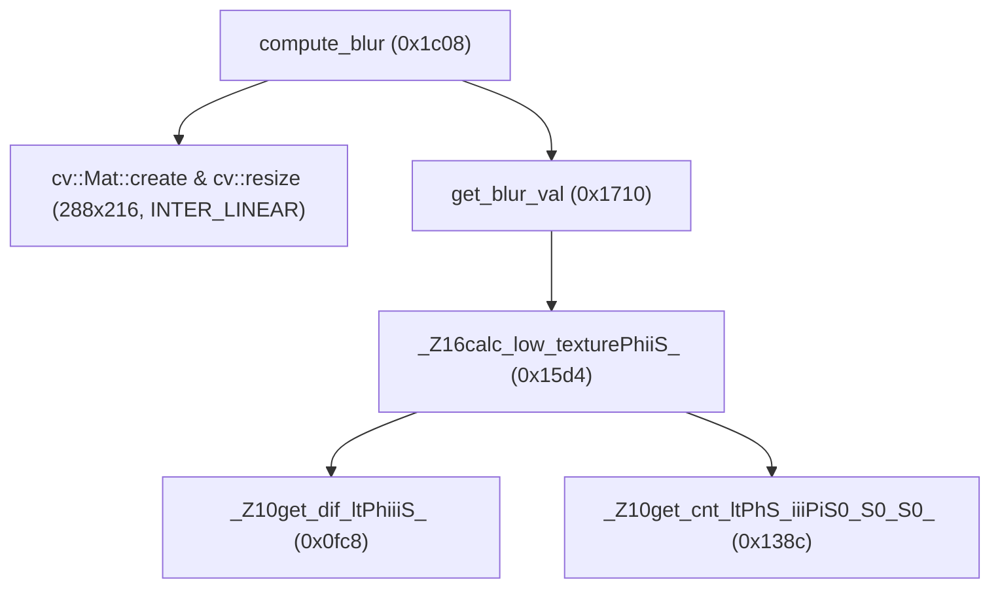

# Stage 1 — Camera Image-Processing DSP Mathematical Model, Call-Graph Reachability & Fossil Debt Audit (`libBlurDetection.camera.samsung.so`)

## 1. Binary Overview & Metadata

- **Artifact Name:** `libBlurDetection.camera.samsung.so`
- **SHA-256 Digest:** `07baf5e21a19cd1c53ab61aa47c19949da47e1bbbeb66f855a67e2b2c19d5615`
- **Format / Architecture:** `ELF64` (`AArch64` / `arm64`, little-endian, stripped static symbols, dynamic C/C++ Itanium ABI symbol table intact)
- **Segments:**
  - `LOAD_0`: `0x0000..0x6ba8` (`27,560` bytes — `.dynsym`, `.dynstr`, `.rela.plt`, `.plt`, `.text`, `.rodata`)
  - `LOAD_1`: `0x16d10..0x17260` (`1,360` bytes — `.dynamic`, `.got`, `.data`, `.bss`)

---

## 2. Exported C/C++ Function Signatures & Call-Graph Topology

| Address | Mangled Symbol | Recovered C/C++ Signature | Role in DSP Pipeline |
| :--- | :--- | :--- | :--- |
| `0x0fc8` | `_Z10get_dif_ltPhiiiS_` | `int get_dif_lt(uint8_t* src, int stride, int width_lt, int height_lt, uint8_t* diff_buf)` | Computes 1st-order horizontal and vertical absolute neighbor differences (`dx`, `dy`) and applies a 2-pixel local directional max filter (`max(d[i], d[i+1])`). |
| `0x138c` | `_Z10get_cnt_ltPhS_iiiPiS0_S0_S0_` | `int get_cnt_lt(uint8_t* dx_buf, uint8_t* dy_buf, int stride_lt, int blocks_x, int blocks_y, int* out_cnt_x, int* out_cnt_y, int* unused_3, int* unused_4)` | Partitions the filtered gradient planes into non-overlapping `4×4` pixel blocks and counts blocks whose 16-pixel directional gradient sum is `< 40`. Leaves `unused_3` (`x7`) and `unused_4` (`[sp]`) unwritten (`SAM-BUG-10b`). |
| `0x15d4` | `_Z16calc_low_texturePhiiS_` | `int calc_low_texture(uint8_t* img, int width, int height, uint8_t* work_buf)` | Evaluates low-texture block counts across the interior ROI (`width_lt × height_lt`). Reads the unwritten 3rd counter slot `[sp, #0x8]` at `0x16bc`, reducing the return value to `(uint32_t)thresh >> 31` (`SAM-BUG-10b`). |
| `0x1710` | `get_blur_val` | `extern "C" int get_blur_val(uint8_t* img, int width, int height, uint8_t* work_buf)` | Computes multi-scale directional sharpness ratios across `16×8` macroblocks (strided by 16 pixels in `y` and `x` starting at `(5, 5)`) and returns an integer sharpness score in `[0, 100]` (or `-100` if `calc_low_texture` returns non-zero). |
| `0x1c08` | `compute_blur` | `extern "C" int compute_blur(uint8_t* img_data, int width, int height)` | Top-level entry point: wraps `img_data` (`height × width`, `CV_8UC1`), downsamples via `cv::resize` (`INTER_LINEAR`) to `288×216` (`width=288, height=216`), allocates working memory via unchecked `malloc(0x4bf00)` (`SAM-BUG-10`), invokes `get_blur_val`, and returns `100 - get_blur_val(...)`. |

### Call-Graph Hierarchy

---

## 3. Discovered Upstream Defects (`SAM-BUG-10` & `SAM-BUG-10b`)

### 3.1 `SAM-BUG-10` — Unchecked `malloc(0x4bf00)` & Raw Pointer Aliasing / 32-Bit Dimension Overflow
- **Location:** `compute_blur` (`0x1c54: mov w0, #0xbf00; movk w0, #0x4, lsl #16; bl malloc@PLT`) and `get_blur_val` (`0x1764..0x1780`).
- **Mechanism:** `compute_blur` allocates `311,040` bytes (`5 * 288 * 216`) via `malloc` and passes the returned pointer `x0` directly into `get_blur_val` (`x3 = work_buf`) without a `NULL` check. Inside `get_blur_val`, `work_buf` is first passed as `uint8_t*` to `calc_low_texture` (which splits it into `dx_buf` and `dy_buf`) and then re-aliased as two `uint16_t*` planes (`buf_v = (uint16_t*)work_buf` and `buf_h = (uint16_t*)(work_buf + 2 * width * height)`), with `2 * width * height` computed in 32-bit signed arithmetic (`mul w8, w20, w19; lsl w8, w8, #1`).
- **Safe Rust Remediation:** [`src/lib.rs`](../src/lib.rs) bounds `width` and `height` to `[10, 16_384]`, replaces raw pointer aliasing with disjoint bounds-checked slices (`split_at_mut(plane_len)`) and strongly typed `Vec<u16>` planes (`buf_v`, `buf_h`), and eliminates unchecked C heap allocation.

### 3.2 `SAM-BUG-10b` — Fossilized 3rd Counter Pointer Rendering `LOW_TEXTURE_SENTINEL` (`-100`) Unreachable
- **Location:** `_Z10get_cnt_ltPhS_iiiPiS0_S0_S0_` (`0x138c..0x15d0`) and `_Z16calc_low_texturePhiiS_` (`0x1680..0x16e0`).
- **Mechanism:**
  1. At `0x1680..0x1698`, `_Z16calc_low_texturePhiiS_` zeroes four 32-bit stack integers at `[sp, #0x0..0x10]` (`stp xzr, xzr, [sp, #0x0]; str xzr, [sp, #0x10]`) and passes their addresses in `x5` (`&cnt_x` at `[sp, #0x10]`), `x6` (`&cnt_y` at `[sp, #0xc]`), `x7` (`&cnt_3` at `[sp, #0x8]`), and `[sp]` (`&cnt_4` at `[sp, #0x4]`) to `_Z10get_cnt_ltPhS_iiiPiS0_S0_S0_`.
  2. Although `_Z10get_cnt_ltPhS_iiiPiS0_S0_S0_` takes four `int*` output parameters in its mangled C++ signature, its implementation (`0x138c..0x15d0`) only stores `cnt_x` to `*x5` (`str w9, [x5]` at `0x15c4`) and `cnt_y` to `*x6` (`str w8, [x6]` at `0x15c8`), never touching `x7` or `[sp]`.
  3. Back in `_Z16calc_low_texturePhiiS_`, after verifying `10 * cnt_x > 9 * total_blocks` (`0x16a4..0x16ac`) and `10 * cnt_y > 9 * total_blocks` (`0x16b0..0x16b8`), instruction `0x16bc` loads the unwritten 3rd counter `ldr w8, [sp, #0x8]` (which is always `0`) and tests `10 * 0 > 9 * total_blocks` (`0 > thresh`), which the compiler strength-reduced at `0x16d8` to `lsr w0, w9, #31` (`((thresh as u32) >> 31) as i32`).
  4. Because `thresh = 9 * blocks_x * blocks_y >= 0` for all valid image dimensions, `calc_low_texture` always returns `0`, making `return -100` (`0x1750: mov w0, #-100`) in `get_blur_val` dead code on every frame.
- **Dual Oracle + Remediated Reconstruction:** [`calc_low_texture`](../src/lib.rs#L121-L149) and [`get_blur_val`](../src/lib.rs#L208-L287) preserve bit-exact C-oracle behavior for differential verification, while [`calc_low_texture_remediated`](../src/lib.rs#L156-L180) and [`get_blur_val_remediated`](../src/lib.rs#L292-L309) restore the intended `90%` horizontal + vertical low-texture threshold so flat images return `LOW_TEXTURE_SENTINEL` (`-100`).

---

## 4. `.rodata` Mathematical Constants (`0x57b8..0x5800`)

| Address | Raw Bytes (Hex) | Data Type | Decoded Value | Usage |
| :--- | :--- | :--- | :--- | :--- |
| `0x57b8` | `00 00 00 00 00 00 59 40` | `f64` (IEEE-754) | `100.0` | Percentage scaling factor at the end of `get_blur_val` (`(int)(score * 100.0)`). |
| `0x57c0` | `00 00 ff 42 02 00 00 00` | `f32` + `i32` | `127.5f`, `2` | `cv::Mat` header initialization (`flags = 0x42ff0000` (`MAGIC_VAL \| CV_8UC1`), `dims = 2`). |
| `0x57c8` | `d8 00 00 00 20 01 00 00` | `[i32; 2]` | `[216, 288]` | Target `cv::Mat::create` dimensions (`rows = 216`, `cols = 288`). |
| `0x57d0` | `20 01 00 00 d8 00 00 00` | `cv::Size_<int>` | `{ width: 288, height: 216 }` | Target `cv::Size(288, 216)` passed to `cv::resize(..., dsize, 0.0, 0.0, INTER_LINEAR=1)`. |

---

## 5. Detailed Mathematical DSP Specification

### 5.1 `_Z10get_dif_ltPhiiiS_` (`0x0fc8`)
- **Pass 1 — First-Order Absolute Differences (`0x1034..0x12cc`):**
  For each `y in 0..height_lt` and `x in 0..(width_lt - 1)` (where $W_{\mathrm{lt}} = \mathrm{width\_lt}$):
  $$\mathrm{dx}_{\mathrm{buf}}[y \cdot W_{\mathrm{lt}} + x] = \left|\mathrm{src}[y \cdot \mathrm{stride} + x] - \mathrm{src}[y \cdot \mathrm{stride} + x + 1]\right|$$
  $$\mathrm{dy}_{\mathrm{buf}}[y \cdot W_{\mathrm{lt}} + x] = \left|\mathrm{src}[y \cdot \mathrm{stride} + x] - \mathrm{src}[(y + 1) \cdot \mathrm{stride} + x]\right|$$
- **Pass 2 — 2-Tap Directional Maximum Filter (`0x12d0..0x1364`):**
  For each `y in 0..(height_lt - 1)` and `x in 0..(width_lt - 1)`:
  $$\mathrm{dx}_{\mathrm{buf}}[y \cdot W_{\mathrm{lt}} + x] = \max\left(\mathrm{dx}_{\mathrm{buf}}[y \cdot W_{\mathrm{lt}} + x],\; \mathrm{dx}_{\mathrm{buf}}[y \cdot W_{\mathrm{lt}} + x + 1]\right)$$
  $$\mathrm{dy}_{\mathrm{buf}}[y \cdot W_{\mathrm{lt}} + x] = \max\left(\mathrm{dy}_{\mathrm{buf}}[y \cdot W_{\mathrm{lt}} + x],\; \mathrm{dy}_{\mathrm{buf}}[(y + 1) \cdot W_{\mathrm{lt}} + x]\right)$$

### 5.2 `_Z10get_cnt_ltPhS_iiiPiS0_S0_S0_` (`0x138c`)
For each `4×4` block `(by, bx)` in `0..blocks_y × 0..blocks_x`:
$$S_x = \sum_{r=0}^{3} \sum_{c=0}^{3} \mathrm{dx}_{\mathrm{buf}}[(4 \cdot by + r) \cdot W_{\mathrm{lt}} + (4 \cdot bx + c)], \quad S_y = \sum_{r=0}^{3} \sum_{c=0}^{3} \mathrm{dy}_{\mathrm{buf}}[(4 \cdot by + r) \cdot W_{\mathrm{lt}} + (4 \cdot bx + c)]$$
Increments `cnt_x` when `(int32_t)((uint32_t)S_x << 16) < (40 << 16)` and `cnt_y` when `(int32_t)((uint32_t)S_y << 16) < (40 << 16)`.

### 5.3 `get_blur_val` (`0x1710`)
- **Multi-Scale Residual Planes (`0x1754..0x1908`):**
  For `y in 4..(height - 5)` and `x in 4..(width - 5)`:
  $$d_{h1} = |\mathrm{img}[y, x] - \mathrm{img}[y, x+1]|, \quad d_{v1} = |\mathrm{img}[y, x] - \mathrm{img}[y+1, x]|$$
  $$d_{h9} = |\mathrm{img}[y, x+5] - \mathrm{img}[y, x-4]|, \quad d_{v9} = |\mathrm{img}[y+5, x] - \mathrm{img}[y-4, x]|$$
  $$\mathrm{buf}_v[(y - 4) \cdot (\mathrm{width} - 9) + (x - 4)] = \max\left(0,\; 9 \cdot d_{v1} - d_{v9}\right)$$
  $$\mathrm{buf}_h[(y - 4) \cdot (\mathrm{width} - 9) + (x - 4)] = \max\left(0,\; 9 \cdot d_{h1} - d_{h9}\right)$$
- **`16×8` Macroblock Sharpness Ratio Accumulation (`0x190c..0x1be4`):**
  Iterates `by` from `5` to `height - 21` (step `16`) and `bx` from `5` to `width - 21` (step `16`), accumulating `S_v1`, `S_h1`, `R_v`, and `R_h` over each `16×8` macroblock (`r = 15..0`, `c = 0..7`). Updates `ratio_v = 1.0 - R_v / (9.0 * S_v1)` (when `S_v1 != 0`) and adds `ratio_v` to `acc_v` when `((uint32_t)(S_v1 - 400) >> 4) < 475u` (and analogously for horizontal gradients). Returns `(int)(final_ratio * 100.0)`.
